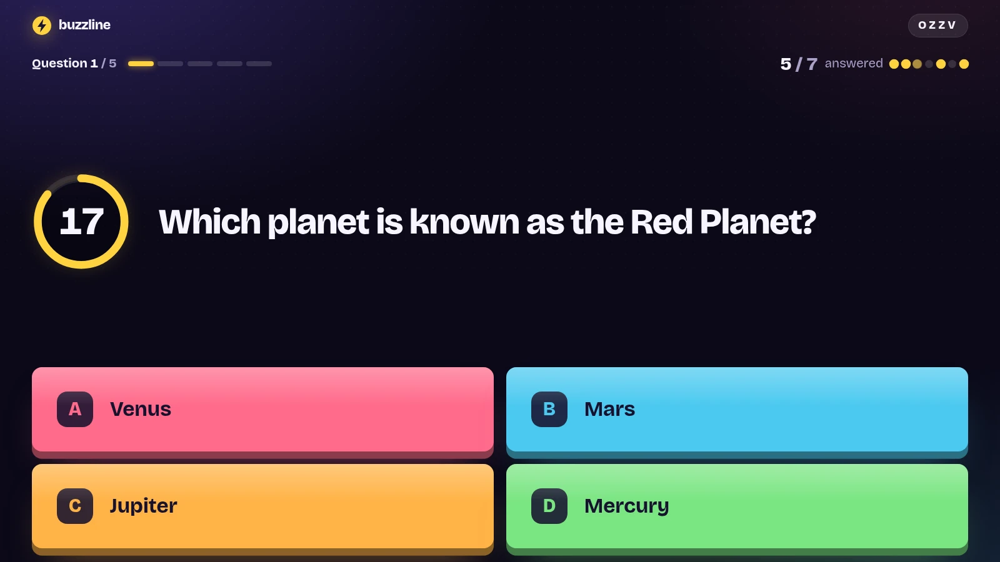
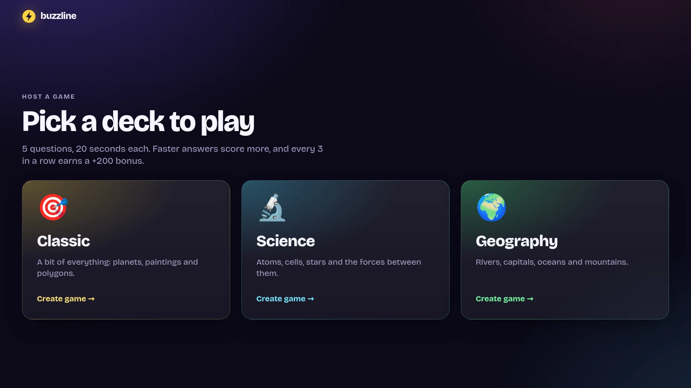
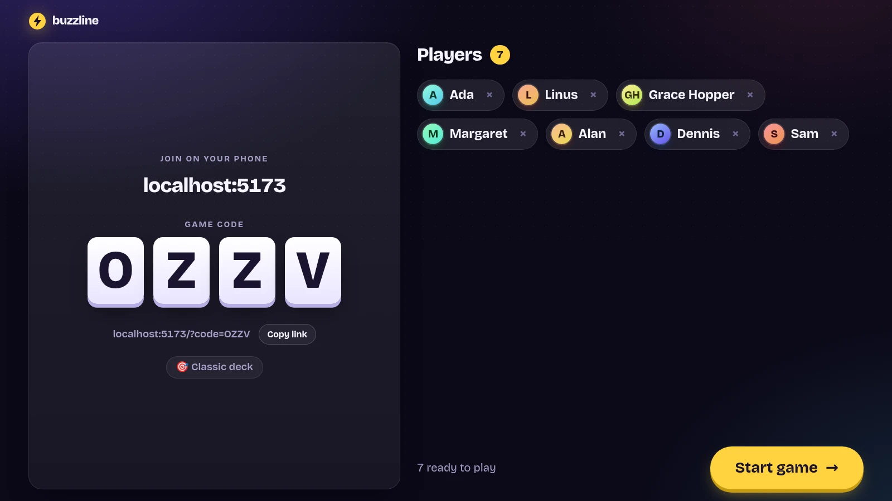
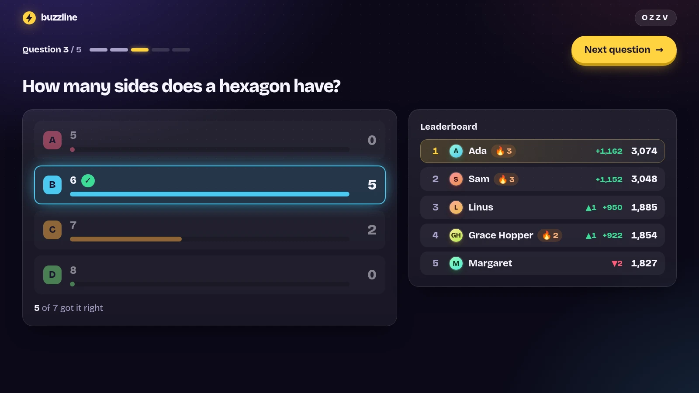
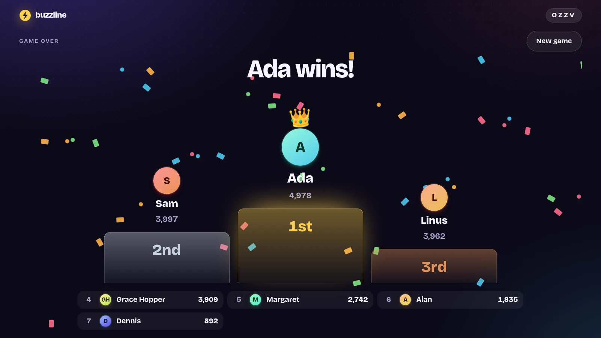
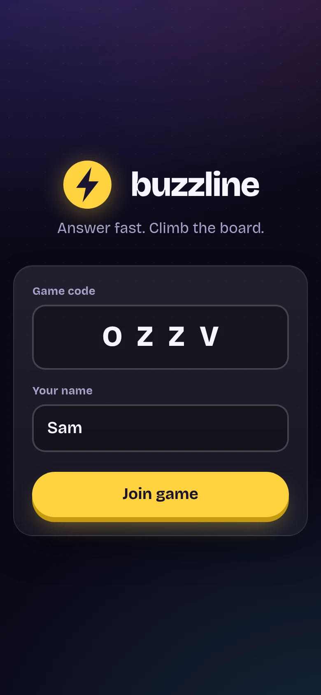
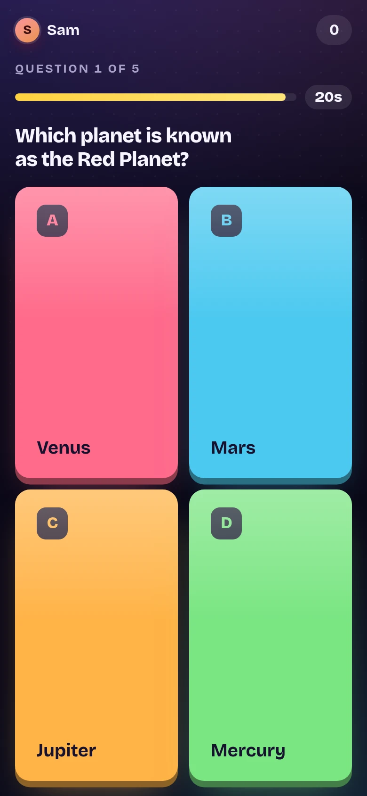
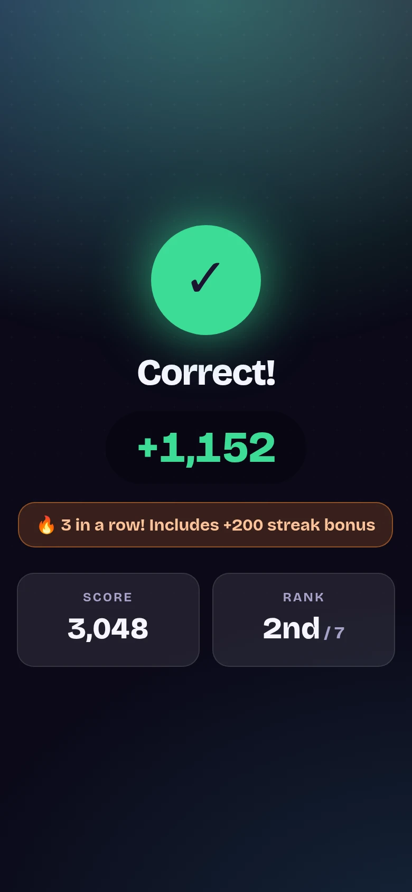
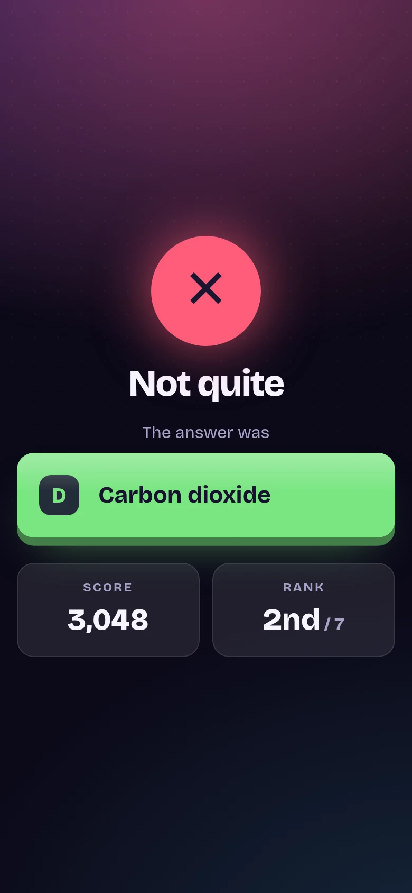
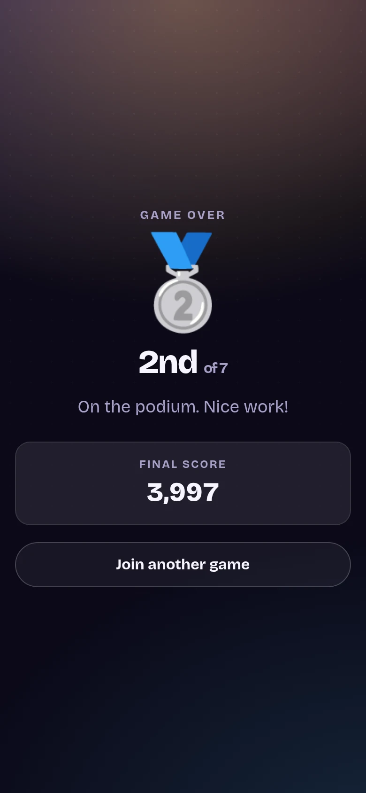

<p align="center">
  
</p>

<h1 align="center">Buzzline</h1>

<p align="center">
  <b>A fast, colorful multiplayer quiz.</b><br />
  Host on the big screen. Everyone else plays from their phone.
</p>

<p align="center">
  
  
  
  
  
</p>

<p align="center">
  
</p>

---

## How it plays

1. **Host a game.** Open `/host` on a laptop hooked up to a TV or projector and pick a deck. A four-letter game code appears.
2. **Join from a phone.** Players open the join link (or type the code) and pick a name. No app, no account.
3. **Answer fast.** Each question runs for 20 seconds. The faster you lock in a correct answer, the more points you score, and every three in a row earns a streak bonus.
4. **Climb the board.** After each question the big screen reveals the answer, how everyone voted, and who moved up. After five questions the podium crowns a winner.

## On the big screen

<table>
  <tr>
    <td width="50%"></td>
    <td width="50%"></td>
  </tr>
  <tr>
    <td align="center"><b>Pick a deck</b><br /><sub>Classic, Science or Geography</sub></td>
    <td align="center"><b>Lobby</b><br /><sub>Big code, join link, kick button on every player</sub></td>
  </tr>
  <tr>
    <td width="50%"></td>
    <td width="50%"></td>
  </tr>
  <tr>
    <td align="center"><b>Reveal</b><br /><sub>Votes per answer, points gained, places moved, streaks</sub></td>
    <td align="center"><b>Podium</b><br /><sub>Top three, full standings, one click to play again</sub></td>
  </tr>
</table>

## In your hand

<table>
  <tr>
    <td align="center"></td>
    <td align="center"></td>
    <td align="center"></td>
    <td align="center"></td>
    <td align="center"></td>
  </tr>
  <tr>
    <td align="center"><sub><b>Join</b></sub></td>
    <td align="center"><sub><b>Answer</b></sub></td>
    <td align="center"><sub><b>Correct!</b></sub></td>
    <td align="center"><sub><b>Not quite</b></sub></td>
    <td align="center"><sub><b>Final rank</b></sub></td>
  </tr>
</table>

## Features

- **Two screens, one game.** The host view scales to any TV or projector. The player view is built for thumbs.
- **Live and server-authoritative.** Every change is pushed over a WebSocket, and the server owns all state and scoring. Correct answers never reach a client before the reveal.
- **Speed scoring and streaks.** Points reward quick answers, and every third correct answer in a row adds a bonus.
- **Readable at a glance.** Each answer has its own color *and* a letter (A–D), so color is never the only cue.
- **Built for real rooms.** Players can reload and rejoin mid-game, the host can kick players from the lobby, and lost connections are clearly flagged.
- **Respects reduced motion.** Confetti and animations calm down when the OS asks for less motion.

## Scoring

| Event | Points |
| --- | --- |
| Correct answer | `500 + round(500 × time left / 20s)`, so 500 to 1,000 |
| Every 3rd correct answer in a row | **+200** streak bonus |
| Wrong or no answer | 0, and the streak resets |

The full rules and message protocol live in [`docs/CONTRACT.md`](docs/CONTRACT.md).

## Getting started

You need Node.js 18 or newer.

```bash
npm install
npm run dev
```

This starts the game server on **:4000** and the web app on **:5173**.

- **Host:** open <http://localhost:5173/host> and pick a deck.
- **Players:** on the same Wi-Fi, open the address Vite prints under `Network` (for example `http://192.168.1.20:5173`) and enter the code, or use the join link shown in the lobby.

## Scripts

| Command | What it does |
| --- | --- |
| `npm run dev` | Server and web app with hot reload |
| `npm run check` | Typecheck every workspace, then run all tests |
| `npm test` | Tests only |
| `npm run build -w web` | Production build of the web app |

## Project layout

```text
buzzline/
├── shared/        Types shared by server and web (GameState, messages, decks)
├── server/        Express + ws game server; game logic takes an injected clock
│   └── src/deck.ts    Question decks
├── web/           Vite + React client
│   └── src/
│       ├── host/      Big-screen views
│       ├── player/    Phone views
│       ├── lib/       Shared hooks, components and helpers
│       └── styles.css Design tokens and all styling
└── docs/
    └── CONTRACT.md    Messages and game rules (source of truth)
```

## Adding a deck

1. Add the questions to `server/src/deck.ts` (exactly four choices each) and register the deck in `decks`.
2. Add its id and name to `DECKS` in `shared/src/index.ts`.
3. Give it an emoji and a blurb in `DECK_INFO` in `web/src/host/App.tsx`.
4. List the new `deckId` in `docs/CONTRACT.md`.
